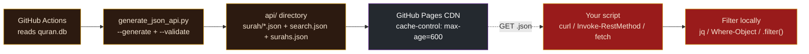

# API Reference - Quran Database Malay

A thorough reference for the static JSON API published at **`https://C-Fu.github.io/quran-database-malay`**. This is a Malay-focused fork of [`AbdullahGhanem/quran-database`](https://github.com/AbdullahGhanem/quran-database); every verse carries the **Basmeih Malay translation** (`ms.basmeih`, *Tafsir Pimpinan Ar-Rahman*) alongside the Arabic.

> Companion docs: [README.md](README.md) (overview) | [BASMEIH.md](BASMEIH.md) (translation background + folding rules) | [CONTRIBUTING.md](CONTRIBUTING.md)

---

## Table of contents

- [How it works](#how-it-works)
- [Characteristics at a glance](#characteristics-at-a-glance)
- [Authentication, rate limits & CORS](#authentication-rate-limits--cors)
- [Endpoints](#endpoints)
  - [GET /api/surah/{n}.json](#get-apisurahnnjson)
  - [GET /api/search.json](#get-apisearchjson)
  - [GET /api/surahs.json](#get-apisurahsjson)
- [The verse object](#the-verse-object)
- [Querying & filtering (all platforms)](#querying--filtering-all-platforms)
- [Caching, ETags & freshness](#caching-etags--freshness)
- [Limitations](#limitations)
- [Error behaviour](#error-behaviour)
- [Versioning & stability](#versioning--stability)

---

## How it works

There is **no server**. GitHub Pages serves pre-built JSON files from a CDN. The data is built once, at deploy time, by GitHub Actions (it reads `quran.db`, emits the `api/` tree, validates it, then publishes). All filtering/search happens **client-side** after you download the file you need.



## Characteristics at a glance

| Property | Value |
| --- | --- |
| Base URL | `https://C-Fu.github.io/quran-database-malay` |
| Transport | HTTPS, static files on GitHub Pages CDN |
| Auth | **None** - fully public |
| Rate limit | None (it's a CDN; just be reasonable) |
| Content-Type | `application/json; charset=utf-8` |
| CORS | `Access-Control-Allow-Origin: *` (browser `fetch()` works) |
| Cache | `max-age=600` (10 min) + `ETag` + `Last-Modified` |
| Verses | 6,236 (the full Quran, Hafs narration) |
| Surahs | 114 |
| `api/` build | gitignored, regenerated by CI on every push to `main` |

## Authentication, rate limits & CORS

- **Authentication:** none. No API keys, no tokens, no headers required.
- **Rate limits:** none. GitHub Pages has no per-client quota; if you hammer it, the CDN will still serve, but please cache locally (see [Caching](#caching-etags--freshness)).
- **CORS:** every response carries `Access-Control-Allow-Origin: *`, so a browser page can `fetch()` the JSON directly. **Simple GET requests need no preflight**, so cross-origin fetching "just works".
  - Caveat: an `OPTIONS` preflight returns **`405 Method Not Allowed`** (GitHub Pages does not handle the `OPTIONS` verb). A plain `fetch(url)` (a "simple request") does *not* trigger a preflight, so it succeeds. But if you add custom request headers (e.g. `Authorization`), the browser will preflight with `OPTIONS` and the request will fail. **Don't add custom headers** - there's nothing to authenticate anyway.

## Endpoints

### `GET /api/surah/{n}.json`

Returns an array of every ayah in surah `n` (1-114). Each element is a [verse object](#the-verse-object) with Arabic + Basmeih Malay.

**Path parameters**

| Name | Type | Range | Example |
| --- | --- | --- | --- |
| `n` | integer | 1-114 | `2` = Al-Baqarah |

Out-of-range or non-integer `n` returns `404` (see [Error behaviour](#error-behaviour)).

#### Examples - fetch surah 2 (Al-Baqarah)

**macOS / Linux** (curl is preinstalled):
```bash
curl https://C-Fu.github.io/quran-database-malay/api/surah/2.json
```

**Windows** - PowerShell (`curl` is aliased to `Invoke-WebRequest` in PowerShell, so use `Invoke-RestMethod`):
```powershell
Invoke-RestMethod https://C-Fu.github.io/quran-database-malay/api/surah/2.json
```

**Windows** - cmd.exe with real `curl.exe` (ships in Windows 10+), saving to a file:
```cmd
curl.exe -o surah2.json https://C-Fu.github.io/quran-database-malay/api/surah/2.json
```

**Python** (cross-platform):
```python
import urllib.request, json
with urllib.request.urlopen("https://C-Fu.github.io/quran-database-malay/api/surah/2.json") as r:
    surah = json.load(r)
print(len(surah))   # 286
print(surah[0])     # first ayah
```

**Browser JavaScript:**
```js
const surah = await fetch("https://C-Fu.github.io/quran-database-malay/api/surah/2.json").then(r => r.json());
console.log(surah.length);   // 286
```

**Sample response** (first element of surah 2; array length = ayah count):
```json
[
  {
    "arabic": "بِسْمِ ٱللَّهِ ٱلرَّحْمَٰنِ ٱلرَّحِيمِ الٓمٓ",
    "malay": "Alif, Laam, Miim.",
    "surah": 2,
    "ayah": 1,
    "id": 8
  }
]
```
> The first 7 `id`s belong to Al-Fatiha (surah 1, 7 verses), so Al-Baqarah 1:1 has global `id` 8. `id` is the global ayah id (1-6236), not the ayah-within-surah.

---

### `GET /api/search.json`

Returns the **full search index**: a flat JSON array of all **6,236** verse objects in global-`id` order (the natural Quranic order). Size: **~3.2 MB** (`content-length: 3213062`).

This is the one file the [browser search page](https://C-Fu.github.io/quran-database-malay/) downloads on load; you can use the same file to build your own search/filter client-side.

#### Examples

**macOS / Linux** - fetch once, then filter with [`jq`](https://jqlang.github.io/jq/):
```bash
# All verses whose Malay translation contains "rahmat"
curl -s https://C-Fu.github.io/quran-database-malay/api/search.json \
  | jq '[.[] | select(.malay | contains("rahmat"))]'
```

```bash
# Count of such verses (case-sensitive contains)
curl -s https://C-Fu.github.io/quran-database-malay/api/search.json \
  | jq '[.[] | select(.malay | contains("rahmat"))] | length'   # -> 174
```

**Windows** - PowerShell (no `jq` needed):
```powershell
$verses = Invoke-RestMethod https://C-Fu.github.io/quran-database-malay/api/search.json
$verses | Where-Object malay -match 'rahmat' | Select-Object surah, ayah, malay
```

**Python:**
```python
import urllib.request, json
with urllib.request.urlopen("https://C-Fu.github.io/quran-database-malay/api/search.json") as r:
    verses = json.load(r)
hits = [v for v in verses if "rahmat" in v["malay"].lower()]   # case-insensitive
print(len(hits))
```

**Browser JavaScript:**
```js
const verses = await fetch("https://C-Fu.github.io/quran-database-malay/api/search.json").then(r => r.json());
const hits = verses.filter(v => v.malay.toLowerCase().includes("rahmat"));
console.log(hits.length);
```

**Tip - cache it locally** (3.2 MB; no need to re-download every run):
```bash
# macOS / Linux
curl -s https://C-Fu.github.io/quran-database-malay/api/search.json -o search.json
jq '[.[] | select(.malay | contains("rahmat"))]' search.json
```
```powershell
# Windows PowerShell
Invoke-RestMethod https://C-Fu.github.io/quran-database-malay/api/search.json -OutFile search.json
(Get-Content search.json | ConvertFrom-Json) | Where-Object malay -match 'rahmat'
```

**Single verse object** (id 1 = Al-Fatiha 1:1):
```json
{
  "arabic": "بِسْمِ ٱللَّهِ ٱلرَّحْمَٰنِ ٱلرَّحِيمِ",
  "malay": "Dengan nama Allah, Yang Maha Pemurah, lagi Maha Mengasihani.",
  "surah": 1,
  "ayah": 1,
  "id": 1
}
```

---

### `GET /api/surahs.json`

Returns metadata for all **114** surahs.

#### Examples

**macOS / Linux:**
```bash
curl https://C-Fu.github.io/quran-database-malay/api/surahs.json
```

**Windows (PowerShell):**
```powershell
Invoke-RestMethod https://C-Fu.github.io/quran-database-malay/api/surahs.json
```

**Find a surah by English name** (macOS / Linux, jq):
```bash
curl -s https://C-Fu.github.io/quran-database-malay/api/surahs.json \
  | jq '.[] | select(.name_en_translation=="The Cow")'
```

**Windows (PowerShell):**
```powershell
(Invoke-RestMethod https://C-Fu.github.io/quran-database-malay/api/surahs.json) |
  Where-Object name_en_translation -eq 'The Cow'
```

**Sample response** (first 2 of 114):
```json
[
  {"number":1,"name_ar":"سورة الفاتحة","name_en":"Al-Faatiha","name_en_translation":"The Opening","type":"Meccan","ayah_count":7},
  {"number":2,"name_ar":"سورة البقرة","name_en":"Al-Baqara","name_en_translation":"The Cow","type":"Medinan","ayah_count":286}
]
```

## The verse object

Every verse (in `/api/surah/{n}.json` and `/api/search.json`) has exactly **5 fields**:

| Field | Type | Meaning |
| --- | --- | --- |
| `arabic` | string | The ayah text in Arabic (with full diacritics) |
| `malay` | string | The Basmeih Malay translation |
| `surah` | integer | Surah number (1-114) |
| `ayah` | integer | Ayah number within the surah (1..N) |
| `id` | integer | **Global** ayah id (1-6236) - the verse's position in the whole Quran |

> 💡 **"`ayah`" = verse, not dad.** From Arabic آية (*āyah*, "sign/verse") - the same word as *ayat* in Bahasa Melayu. It does **not** mean the everyday Malay word *ayah* ("father"). `"ayah": 1` is verse 1.

The `surahs.json` objects use a different shape - see its [sample response](#get-apisurahsjson).

## Querying & filtering (all platforms)

There is **no server-side query language, no query parameters, and no pagination**. You fetch a whole file and filter client-side. This table maps the common idioms:

| Task | macOS / Linux (`jq`) | Windows (PowerShell) |
| --- | --- | --- |
| Verses containing a Malay word | `select(.malay \| contains("rahmat"))` | `Where-Object malay -match 'rahmat'` |
| Case-insensitive | `select((.malay\|ascii_downcase)\|contains("rahmat"))` | `Where-Object malay -match '(?i)rahmat'` |
| All terms must match (AND) | `select((.malay\|contains("a")) and (.malay\|contains("b")))` | `Where-Object { $_.malay -match 'a' -and $_.malay -match 'b' }` |
| A specific surah+ayah | `select(.surah==2 and .ayah==255)` | `Where-Object { $_.surah -eq 2 -and $_.ayah -eq 255 }` |
| Count matches | `[\|...] \| length` | `(\| ...).Count` |
| First N | `[\|...][0:N]` | `Select-Object -First N` |

**Case sensitivity:** `jq`'s `contains` and PowerShell's `-match` differ - `jq contains` is case-sensitive (use `ascii_downcase`); PowerShell `-match` is case-insensitive by default.

## Caching, ETags & freshness

Responses include:
```
cache-control: max-age=600
etag: "6a6d4c9c-310706"
last-modified: Sat, 01 Aug 2026 01:32:12 GMT
```

- **Browser/CDN cache:** 10 minutes (`max-age=600`). After a deploy, stale responses may be served for up to ~10 min.
- **Conditional requests:** for a polling/CLI client, send `If-None-Match: "<etag>"` or `If-Modified-Since: <date>`; a unchanged resource returns `304 Not Modified` with no body (saves bandwidth). curl: `curl --etag-save etags.txt --etag-compare etags.txt <url>`.
- **Local caching:** for `search.json` (3.2 MB), download once per session and reuse - the examples above show this pattern.

## Limitations

- **No server-side search/filter.** Search is *client-side only*: download `search.json`, then filter with `jq` / PowerShell / your language. The full index is 3.2 MB.
- **No query parameters or pagination.** A URL like `/api/search.json?q=rahmat` is ignored (static files); `/api/surah/2.json?page=1` returns the whole surah.
- **No per-ayah endpoint.** There is no `/api/ayah/255.json` - use `/api/surah/2.json` and pick `.ayah == 255`, or filter `search.json` by `surah` + `ayah` / global `id`.
- **One edition per verse object.** Each verse carries only the **Basmeih** Malay translation. The database (`quran.db`) has 134 editions; the JSON API exposes only Arabic + Basmeih. To serve other editions, extend [`generate_json_api.py`](generate_json_api.py).
- **The site root has the search UI.** `/` serves `index.html` (the QuestUI page), not JSON.
- **No `OPTIONS` / preflight support.** Simple cross-origin `GET` works (CORS `*`); requests that trigger a preflight fail with `405`.
- **Basmala merging.** In the source data the basmala is occasionally concatenated into the first ayah of a surah (e.g. surah 2 / ayah 1). This is a data-source quirk, not an API defect - see [BASMEIH.md](BASMEIH.md).
- **No webhooks / streaming / SSE.** Static files only.
- **`id` is Hafs-narration ayah numbering** (6,236 ayahs). Other qirā'āt count differently.

## Error behaviour

Static hosting means errors are served by GitHub Pages, not application code.

| Case | Status | Body |
| --- | --- | --- |
| Valid endpoint | `200` | the JSON document |
| `n` out of range (`0`, `115+`), non-integer (`abc`), or missing surah file | `404` | GitHub Pages HTML 404 page (not JSON) |
| Unknown path (`/api/nope.json`) | `404` | GitHub Pages HTML 404 page |
| `OPTIONS` preflight | `405 Method Not Allowed` | empty |
| Anything else | - | GitHub Pages default behaviour |

> Because 404 bodies are HTML, **don't try to `json.loads()` a response without checking the status code / content-type first.** curl: use `-f`/`--fail` to make errors exit non-zero; PowerShell: check `$resp`/`-StatusCode`; Python: check `resp.status` before `json.load`.

## Versioning & stability

- The **URL structure and verse object shape** (`{arabic, malay, surah, ayah, id}`) are stable and considered the public contract.
- The **content** (the actual Arabic/Malay text) updates whenever a correction is pushed and CI redeploys; rely on `ETag`/`Last-Modified` to detect changes.
- Breaking changes to the shape would increment the path (e.g. a future `/api/v2/...`); no such change is planned.
