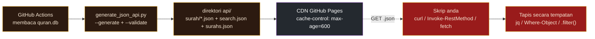

# Rujukan API - Pangkalan Data Quran Melayu

Rujukan menyeluruh untuk API JSON statik yang diterbitkan di **`https://C-Fu.github.io/quran-database-malay`**. Ini ialah fork berfokus Melayu daripada [`AbdullahGhanem/quran-database`](https://github.com/AbdullahGhanem/quran-database); setiap ayat membawa **terjemahan Melayu Basmeih** (`ms.basmeih`, *Tafsir Pimpinan Ar-Rahman*) bersama teks Arab.

> Dokumen berkaitan: [README.ms-MY.md](README.ms-MY.md) (gambaran keseluruhan) | [BASMEIH.ms-MY.md](BASMEIH.ms-MY.md) (latar belakang terjemahan + peraturan lipatan) | [CONTRIBUTING.md](CONTRIBUTING.md)

---

## Jadual kandungan

- [Bagaimana ia berfungsi](#bagaimana-ia-berfungsi)
- [Ciri pada sekali pandang](#ciri-pada-sekali-pandang)
- [Pengesahan, had kadar & CORS](#pengesahan-had-kadar--cors)
- [Titik akhir](#titik-akhir)
  - [GET /api/surah/{n}.json](#get-apisurahnnjson)
  - [GET /api/search.json](#get-apisearchjson)
  - [GET /api/surahs.json](#get-apisurahsjson)
- [Objek ayat](#objek-ayat)
- [Pertanyaan & penapisan (semua platform)](#pertanyaan--penapisan-semua-platform)
- [Pengecapan, ETag & kesegaran](#pengecapan-etag--kesegaran)
- [Had](#had)
- [Kelakuan ralat](#kelakuan-ralat)
- [Pembungkusan & kestabilan](#pembungkusan--kestabilan)

---

## Bagaimana ia berfungsi

**Tiada pelayan.** GitHub Pages menyajikan fail JSON yang dibina lebih awal daripada CDN. Data dibina sekali, semasa gerak, oleh GitHub Actions (membaca `quran.db`, menghasilkan pepohon `api/`, mengesahkannya, kemudian menerbitkan). Semua penapisan/carian berlaku **di sisi klien** selepas anda memuat turun fail yang diperlukan.



## Ciri pada sekali pandang

| Sifat | Nilai |
| --- | --- |
| URL asas | `https://C-Fu.github.io/quran-database-malay` |
| Pengangkutan | HTTPS, fail statik di CDN GitHub Pages |
| Pengesahan | **Tiada** - sepenuhnya awam |
| Had kadar | Tiada (ini CDN; gunakan secara berpatutan) |
| Content-Type | `application/json; charset=utf-8` |
| CORS | `Access-Control-Allow-Origin: *` (`fetch()` pelayar berfungsi) |
| Cache | `max-age=600` (10 min) + `ETag` + `Last-Modified` |
| Ayat | 6,236 (keseluruhan Al-Quran, riwayat Hafs) |
| Surah | 114 |
| Binaan `api/` | diabaikan-git, dijana semula oleh CI pada setiap push ke `main` |

## Pengesahan, had kadar & CORS

- **Pengesahan:** tiada. Tanpa kunci API, tanpa token, tanpa pengepala.
- **Had kadar:** tiada. GitHub Pages tiada kuota per-klien; jika anda menyanganya, CDN tetap menyajikan, tetapi sila cachenya secara tempatan (lihat [Pengecapan](#pengecapan-etag--kesegaran)).
- **CORS:** setiap respons membawa `Access-Control-Allow-Origin: *`, jadi halaman pelayar boleh `fetch()` JSON terus. **Permintaan GET ringkas tidak memerlukan preflight**, jadi pengambilan rentas-asal "terus berfungsi".
  - Amaran: preflight `OPTIONS` memulangkan **`405 Method Not Allowed`** (GitHub Pages tidak mengendalikan kata kerja `OPTIONS`). `fetch(url)` biasa (permintaan "ringkas") *tidak* mencetuskan preflight, jadi ia berjaya. Tetapi jika anda menambah pengepala permintaan tersendiri (cth. `Authorization`), pelayar akan preflight dengan `OPTIONS` dan permintaan akan gagal. **Jangan tambah pengepala tersendiri** - tiada apa pun untuk disahkan.

## Titik akhir

### `GET /api/surah/{n}.json`

Memulangkan tatasusunan setiap ayat dalam surah `n` (1-114). Setiap elemen ialah [objek ayat](#objek-ayat) dengan Arab + Melayu Basmeih.

**Parameter laluan**

| Nama | Jenis | Julat | Contoh |
| --- | --- | --- | --- |
| `n` | integer | 1-114 | `2` = Al-Baqarah |

`n` di luar julat atau bukan integer memulangkan `404` (lihat [Kelakuan ralat](#kelakuan-ralat)).

#### Contoh - dapatkan surah 2 (Al-Baqarah)

**macOS / Linux** (curl telah dipasang):
```bash
curl https://C-Fu.github.io/quran-database-malay/api/surah/2.json
```

**Windows** - PowerShell (`curl` dialiaskan kepada `Invoke-WebRequest` dalam PowerShell, jadi gunakan `Invoke-RestMethod`):
```powershell
Invoke-RestMethod https://C-Fu.github.io/quran-database-malay/api/surah/2.json
```

**Windows** - cmd.exe dengan `curl.exe` sebenar (disediakan dalam Windows 10+), menyimpan ke fail:
```cmd
curl.exe -o surah2.json https://C-Fu.github.io/quran-database-malay/api/surah/2.json
```

**Python** (rentas-platform):
```python
import urllib.request, json
with urllib.request.urlopen("https://C-Fu.github.io/quran-database-malay/api/surah/2.json") as r:
    surah = json.load(r)
print(len(surah))   # 286
print(surah[0])     # ayat pertama
```

**JavaScript pelayar:**
```js
const surah = await fetch("https://C-Fu.github.io/quran-database-malay/api/surah/2.json").then(r => r.json());
console.log(surah.length);   // 286
```

**Respons contoh** (elemen pertama surah 2; panjang tatasusunan = bilangan ayat):
```json
[
  {
    "arabic": "بِسْمِ ٱللَّهِ ٱلرَّحْمَٰنِ ٱلرَّحِيمِ الٓمٓ",
    "malay": "Alif, Laam, Miim.",
    "surah": 2,
    "ayah": 1,
    "id": 8
  }
]
```
> 7 `id` pertama milik Al-Fatihah (surah 1, 7 ayat), jadi Al-Baqarah 1:1 mempunyai `id` global 8. `id` ialah id ayat global (1-6236), bukan ayat-dalam-surah.

---

### `GET /api/search.json`

Memulangkan **indeks carian penuh**: tatasusunan JSON rata kesemua **6,236** objek ayat dalam tertib `id` global (tertib Quran semula jadi). Saiz: **~3.2 MB** (`content-length: 3213062`).

Inilah fail yang dimuat turun semasa muat oleh [halaman carian pelayar](https://C-Fu.github.io/quran-database-malay/); anda boleh gunakan fail yang sama untuk membina klien carian/penapisan anda sendiri di sisi klien.

#### Contoh

**macOS / Linux** - muat turun sekali, kemudian tapis dengan [`jq`](https://jqlang.github.io/jq/):
```bash
# Semua ayat yang terjemahan Melayunya mengandungi "rahmat"
curl -s https://C-Fu.github.io/quran-database-malay/api/search.json \
  | jq '[.[] | select(.malay | contains("rahmat"))]'
```

```bash
# Bilangan ayat sedemikian (contains peka huruf besar)
curl -s https://C-Fu.github.io/quran-database-malay/api/search.json \
  | jq '[.[] | select(.malay | contains("rahmat"))] | length'   # -> 174
```

**Windows** - PowerShell (tanpa `jq`):
```powershell
$verses = Invoke-RestMethod https://C-Fu.github.io/quran-database-malay/api/search.json
$verses | Where-Object malay -match 'rahmat' | Select-Object surah, ayah, malay
```

**Python:**
```python
import urllib.request, json
with urllib.request.urlopen("https://C-Fu.github.io/quran-database-malay/api/search.json") as r:
    verses = json.load(r)
hits = [v for v in verses if "rahmat" in v["malay"].lower()]   # peka huruf besar&kecil
print(len(hits))
```

**JavaScript pelayar:**
```js
const verses = await fetch("https://C-Fu.github.io/quran-database-malay/api/search.json").then(r => r.json());
const hits = verses.filter(v => v.malay.toLowerCase().includes("rahmat"));
console.log(hits.length);
```

**Tip - cachenya secara tempatan** (3.2 MB; tidak perlu muat turun semula setiap kali):
```bash
# macOS / Linux
curl -s https://C-Fu.github.io/quran-database-malay/api/search.json -o search.json
jq '[.[] | select(.malay | contains("rahmat"))]' search.json
```
```powershell
# Windows PowerShell
Invoke-RestMethod https://C-Fu.github.io/quran-database-malay/api/search.json -OutFile search.json
(Get-Content search.json | ConvertFrom-Json) | Where-Object malay -match 'rahmat'
```

**Objek ayat tunggal** (id 1 = Al-Fatihah 1:1):
```json
{
  "arabic": "بِسْمِ ٱللَّهِ ٱلرَّحْمَٰنِ ٱلرَّحِيمِ",
  "malay": "Dengan nama Allah, Yang Maha Pemurah, lagi Maha Mengasihani.",
  "surah": 1,
  "ayah": 1,
  "id": 1
}
```

---

### `GET /api/surahs.json`

Memulangkan metadata kesemua **114** surah.

#### Contoh

**macOS / Linux:**
```bash
curl https://C-Fu.github.io/quran-database-malay/api/surahs.json
```

**Windows (PowerShell):**
```powershell
Invoke-RestMethod https://C-Fu.github.io/quran-database-malay/api/surahs.json
```

**Cari surah mengikut nama Inggeris** (macOS / Linux, jq):
```bash
curl -s https://C-Fu.github.io/quran-database-malay/api/surahs.json \
  | jq '.[] | select(.name_en_translation=="The Cow")'
```

**Windows (PowerShell):**
```powershell
(Invoke-RestMethod https://C-Fu.github.io/quran-database-malay/api/surahs.json) |
  Where-Object name_en_translation -eq 'The Cow'
```

**Respons contoh** (2 daripada 114 yang pertama):
```json
[
  {"number":1,"name_ar":"سورة الفاتحة","name_en":"Al-Faatiha","name_en_translation":"The Opening","type":"Meccan","ayah_count":7},
  {"number":2,"name_ar":"سورة البقرة","name_en":"Al-Baqara","name_en_translation":"The Cow","type":"Medinan","ayah_count":286}
]
```

## Objek ayat

Setiap ayat (dalam `/api/surah/{n}.json` dan `/api/search.json`) mempunyai tepat **5 medan**:

| Medan | Jenis | Makna |
| --- | --- | --- |
| `arabic` | string | Teks ayat dalam Arab (penuh diakritik) |
| `malay` | string | Terjemahan Melayu Basmeih |
| `surah` | integer | Nombor surah (1-114) |
| `ayah` | integer | Nombor ayat dalam surah (1..N) |
| `id` | integer | Id ayat **global** (1-6236) - kedudukan ayat dalam keseluruhan Quran |

> 💡 **"`ayah`" = ayat, bukan ayah (bapa).** Daripada Arab آية (*āyah*, "tanda/ayat") - perkataan yang sama dengan *ayat* dalam Bahasa Melayu. Ia **tidak** bermaksud perkataan Melayu harian *ayah* ("bapa"). `"ayah": 1` ertinya ayat 1.

Objek `surahs.json` menggunakan bentuk berbeza - lihat [respons contoh](#get-apisurahsjson)nya.

## Pertanyaan & penapisan (semua platform)

**Tiada bahasa pertanyaan sisi-pelayan, tiada parameter pertanyaan, dan tiada pembahagian halaman.** Anda memuat turun keseluruhan fail dan menapis di sisi klien. Jadual ini memetakan idiom lazim:

| Tugas | macOS / Linux (`jq`) | Windows (PowerShell) |
| --- | --- | --- |
| Ayat mengandungi perkataan Melayu | `select(.malay \| contains("rahmat"))` | `Where-Object malay -match 'rahmat'` |
| Peka huruf besar&kecil | `select((.malay\|ascii_downcase)\|contains("rahmat"))` | `Where-Object malay -match '(?i)rahmat'` |
| Semua terma mesti dipadan (AND) | `select((.malay\|contains("a")) and (.malay\|contains("b")))` | `Where-Object { $_.malay -match 'a' -and $_.malay -match 'b' }` |
| Surah+ayat tertentu | `select(.surah==2 and .ayah==255)` | `Where-Object { $_.surah -eq 2 -and $_.ayah -eq 255 }` |
| Bilangkan padanan | `[\|...] \| length` | `(\| ...).Count` |
| N pertama | `[\|...][0:N]` | `Select-Object -First N` |

**Peka huruf:** `contains` jq dan `-match` PowerShell berbeza - `jq contains` peka huruf besar (guna `ascii_downcase`); PowerShell `-match` peka huruf besar&kecil secara lalai.

## Pengecapan, ETag & kesegaran

Respons mengandungi:
```
cache-control: max-age=600
etag: "6a6d4c9c-310706"
last-modified: Sat, 01 Aug 2026 01:32:12 GMT
```

- **Cache pelayar/CDN:** 10 minit (`max-age=600`). Selepas gerak, respons basi mungkin disajikan sehingga ~10 min.
- **Permintaan bersyarat:** untuk klien undi/CLI, hantar `If-None-Match: "<etag>"` atau `If-Modified-Since: <date>`; sumber tidak berubah memulangkan `304 Not Modified` tanpa badan (menjimatkan jalur lebar). curl: `curl --etag-save etags.txt --etag-compare etags.txt <url>`.
- **Pengecapan tempatan:** untuk `search.json` (3.2 MB), muat turun sekali setiap sesi dan guna semula - contoh di atas menunjukkan corak ini.

## Had

- **Tiada carian/penapisan sisi-pelayan.** Carian hanya *di sisi klien*: muat turun `search.json`, kemudian tapis dengan `jq` / PowerShell / bahasa anda. Indeks penuh 3.2 MB.
- **Tiada parameter pertanyaan atau pembahagian halaman.** URL seperti `/api/search.json?q=rahmat` diabaikan (fail statik); `/api/surah/2.json?page=1` memulangkan keseluruhan surah.
- **Tiada titik akhir per-ayat.** Tiada `/api/ayah/255.json` - gunakan `/api/surah/2.json` dan pilih `.ayah == 255`, atau tapis `search.json` mengikut `surah` + `ayah` / `id` global.
- **Satu edisi per objek ayat.** Setiap ayat hanya membawa terjemahan Melayu **Basmeih**. Pangkalan data (`quran.db`) mempunyai 134 edisi; API JSON hanya mendedahkan Arab + Basmeih. Untuk edisi lain, tambahkan [`generate_json_api.py`](generate_json_api.py).
- **Akar tapak mempunyai UI carian.** `/` menyajikan `index.html` (halaman QuestUI), bukan JSON.
- **Tiada sokongan `OPTIONS` / preflight.** `GET` rentas-asal ringkas berfungsi (CORS `*`); permintaan yang mencetuskan preflight gagal dengan `405`.
- **Penggabungan basmala.** Dalam data sumber basmala kadang-kadang digabungkan ke dalam ayat pertama sesebuah surah (cth. surah 2 / ayah 1). Ini keanelian sumber data, bukan cacat API - lihat [BASMEIH.ms-MY.md](BASMEIH.ms-MY.md).
- **Tiada webhook / penstriman / SSE.** Fail statik sahaja.
- **`id` ialah penomboran ayah riwayat Hafs** (6,236 ayat). Qirā'āt lain membilang berbeza.

## Kelakuan ralat

Pengehosan statik bermaksud ralat disajikan oleh GitHub Pages, bukan kod aplikasi.

| Kes | Status | Badan |
| --- | --- | --- |
| Titik akhir sah | `200` | dokumen JSON |
| `n` di luar julat (`0`, `115+`), bukan integer (`abc`), atau fail surah tiada | `404` | halaman HTML 404 GitHub Pages (bukan JSON) |
| Laluan tidak diketahui (`/api/nope.json`) | `404` | halaman HTML 404 GitHub Pages |
| Preflight `OPTIONS` | `405 Method Not Allowed` | kosong |
| Lain-lain | - | kelakuan lalai GitHub Pages |

> Kerana badan 404 ialah HTML, **jangan cuba `json.loads()` respons tanpa menyemak kod status / content-type dahulu.** curl: gunakan `-f`/`--fail` agar ralat keluar bukan-sifar; PowerShell: semak `$resp`/`-StatusCode`; Python: semak `resp.status` sebelum `json.load`.

## Pembungkusan & kestabilan

- **Struktur URL dan bentuk objek ayat** (`{arabic, malay, surah, ayah, id}`) stabil dan dianggap kontrak awam.
- **Kandungan** (teks Arab/Melayu sebenar) dikemas kini apabila pembetulan dilakukan dan CI menggerak semula; andalkan `ETag`/`Last-Modified` untuk mengesan perubahan.
- Perubahan pecah bentuk akan menambahkan laluan (cth. `/api/v2/...` pada masa hadapan); tiada perubahan sedemikian dirancang.
