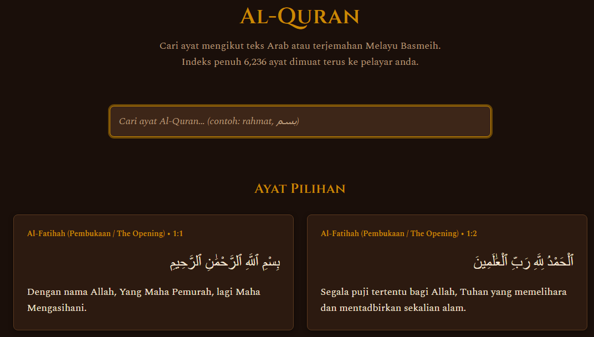
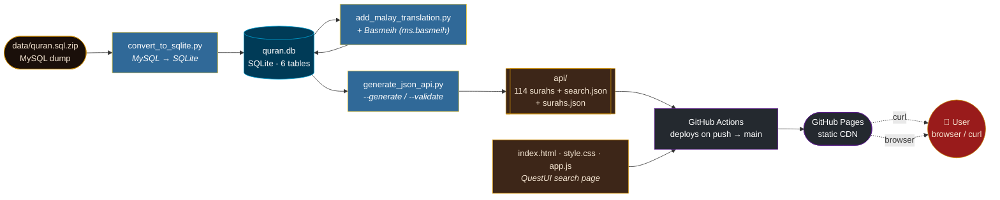
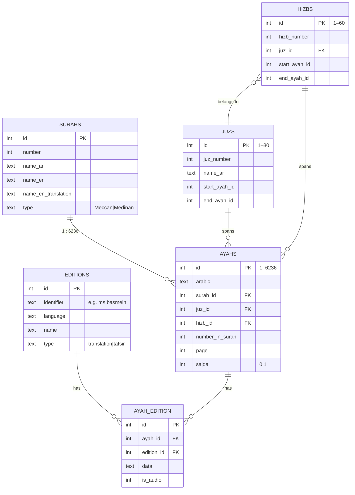
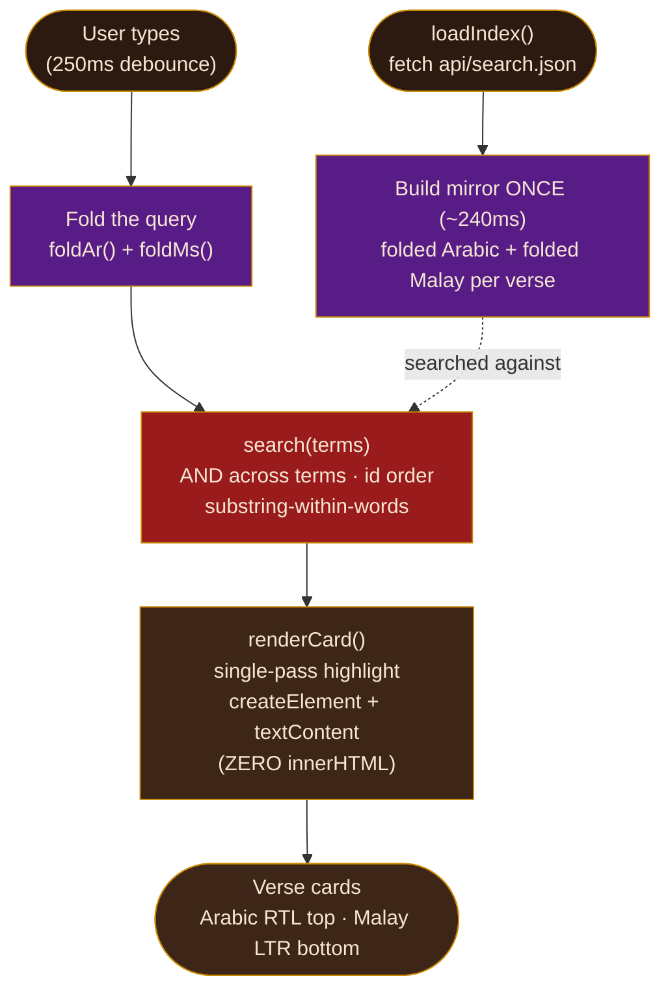

# Al-Quran - Pangkalan Data Melayu (Quran Database Malay)

> Cari ayat Al-Quran mengikut teks Arab dan **terjemahan Melayu Basmeih** - terus dalam pelayar, atau melalui `curl`. Indeks penuh 6,236 ayat dimuat terus ke pelayar anda.

> 📖 Versi penuh dalam Bahasa Melayu tersedia di [README.ms-MY.md](README.ms-MY.md).

> 🇬🇧 English: A Malay-focused fork of the Quran database - search the full Quran by Arabic text or the **Basmeih Malay translation**, in the browser or from the command line. The entire 6,236-verse index loads straight into your browser.

> 🍴 **Fork** of [`AbdullahGhanem/quran-database`](https://github.com/AbdullahGhanem/quran-database) - refocused on the Basmeih (`ms.basmeih`) Malay translation, with a static JSON API on GitHub Pages and a QuestUI-styled browser search page.

---


---

## Contents

- [Quickstart](#quickstart)
- [What this is](#what-this-is)
- [How it all works](#how-it-all-works)
- [The three Python scripts](#the-three-python-scripts)
- [Database schema](#database-schema)
- [The search algorithms](#the-search-algorithms)
- [Search UI (QuestUI)](#search-ui-questui)
- [API reference](#api-reference)
- [Project structure](#project-structure)
- [Contributing](#contributing)
- [Credits & license](#credits--license)

> Companion docs: [API.md](API.md) (full API reference), [BASMEIH.md](BASMEIH.md) (translation background + folding rules), [CONTRIBUTING.md](CONTRIBUTING.md), [llms.txt](llms.txt) (for LLMs). Bahasa Melayu: [README.ms-MY.md](README.ms-MY.md).

---

## Quickstart

### In your browser
Open **<https://C-Fu.github.io/quran-database-malay/>** and type a word - results appear as you type (Malay *and* Arabic, combined).

<p align="center">
  
</p>

> The live QuestUI search page - dark warm background, gold Cinzel headings, as-you-type search with matches highlighted. Each card shows **Arabic (right-to-left)** on top and the **Basmeih Malay** translation below.

### From the command line

No auth, no install - the JSON is public on GitHub Pages. Pick your platform for each task.

> **Windows note:** PowerShell aliases `curl` to `Invoke-WebRequest` and `jq` isn't installed by default - so use the **PowerShell** (`Invoke-RestMethod`) examples below. If you have real `curl` + `jq` installed (e.g. via WSL, Git Bash, or `winget install jqlang.jq`), the macOS/Linux blocks work too.

#### 1. Fetch a whole surah (Arabic + Basmeih Malay) - Al-Baqarah, 286 verses

macOS / Linux:
```bash
curl https://C-Fu.github.io/quran-database-malay/api/surah/2.json
```
Windows (PowerShell):
```powershell
Invoke-RestMethod https://C-Fu.github.io/quran-database-malay/api/surah/2.json
```

#### 2. Keyword-search the Malay translation

macOS / Linux (uses [`jq`](https://jqlang.github.io/jq/)):
```bash
curl -s https://C-Fu.github.io/quran-database-malay/api/search.json \
  | jq '.[] | select(.malay | contains("rahmat"))'
```
Windows (PowerShell - no `jq` needed):
```powershell
(Invoke-RestMethod https://C-Fu.github.io/quran-database-malay/api/search.json) |
  Where-Object malay -match 'rahmat' |
  Select-Object surah, ayah, malay
```

#### 3. List all 114 surahs

macOS / Linux:
```bash
curl https://C-Fu.github.io/quran-database-malay/api/surahs.json
```
Windows (PowerShell):
```powershell
Invoke-RestMethod https://C-Fu.github.io/quran-database-malay/api/surahs.json
```


Every verse object has exactly **5 fields**:
```json
{"arabic":"بِسْمِ ٱللَّهِ ٱلرَّحْمَٰنِ ٱلرَّحِيمِ","malay":"Dengan nama Allah, Yang Maha Pemurah, lagi Maha Mengasihani.","surah":1,"ayah":1,"id":1}
```

> 💡 **"`ayah`" = verse, not dad.** The `ayah` field comes from Arabic آية (*āyah*, "sign/verse") - the same as *ayat* in Bahasa Melayu. It does **not** mean the everyday Malay word *ayah* ("father" / dad). So `"ayah": 1` is verse 1, not "dad 1".

---

## What this is

This project takes the complete Quran (Arabic text + 134 translation editions) and **puts the Basmeih Malay translation front and centre**, exposed three ways:

1. **A curl-able static JSON API** on GitHub Pages - per-surah files, a full search index, and surah metadata.
2. **A browser search page** styled with the [QuestUI](https://designmd.ai/chef/questui) design system - instant as-you-type search over Arabic + Malay.
3. **A query-ready SQLite database** (`quran.db`) with foreign keys, CHECK constraints, indexes, and juz/hizb lookup tables.

**Core value:** *Anyone can `curl` the endpoint and get a Quran verse (Arabic + Basmeih Malay) by searching - fast, reliably, and without auth.*

The Basmeih translation (`ms.basmeih`, *Tafsir Pimpinan Ar-Rahman*) covers all **6,236 ayahs** and is fetched from the public [alquran.cloud](https://alquran.cloud) API.

---

## How it all works

The whole thing is a **build-time pipeline + static hosting** story. There is no server processing requests - GitHub Pages serves pre-built JSON, and the browser does all the searching client-side.



### Build pipeline (runs in GitHub Actions on every push to `main`)

1. **`gunzip quran.db.gz`** - unpack the pre-built SQLite database.
2. **`generate_json_api.py --generate`** - read `quran.db` (read-only), emit `api/` (114 per-surah files, `search.json` with 6,236 verses, `surahs.json` with 114 entries).
3. **`generate_json_api.py --validate`** - assert 114/114 surah files, 6,236 total verses, 0 errors. Non-zero exit fails the build.
4. **Stage `_site/`** - copy `api/` + the 3 UI files (`index.html`, `style.css`, `app.js`) into a staging dir.
5. **`upload-pages-artifact` → `deploy-pages`** - publish to GitHub Pages.

Only `api/` and the 3 UI files ever reach the CDN. The 60 MB `quran.db.gz`, the test file, and all scripts stay off the public site.

---

## The three Python scripts

All scripts use **Python 3 stdlib only** - zero dependencies.

| Script | What it does |
| --- | --- |
| [`convert_to_sqlite.py`](convert_to_sqlite.py) | Streams the MySQL dump (`quran.sql`) into an improved SQLite schema: adds FK/CHECK constraints, 9 indexes, pre-populated `juzs`/`hizbs` lookup tables, and 2 views. Memory-bounded line-based parser. |
| [`add_malay_translation.py`](add_malay_translation.py) | Fetches the Basmeih translation (`ms.basmeih`) from alquran.cloud and inserts an `editions` row + 6,236 `ayah_edition` rows into `quran.db`. |
| [`generate_json_api.py`](generate_json_api.py) | Reads `quran.db` (read-only) and writes the static JSON API. Modes: `--generate` (write `api/`) and `--validate` (verify structure & counts; exit code used by CI). |

### Regenerate everything locally

```bash
# 1. Rebuild the SQLite database from the MySQL dump
unzip data/quran.sql.zip
python3 convert_to_sqlite.py

# 2. Add the Basmeih Malay translation
python3 add_malay_translation.py

# 3. Generate the JSON API and validate it
python3 generate_json_api.py --generate
python3 generate_json_api.py --validate   # → 114/114 files, 6236 verses, 0 errors

# 4. (optional) Run the UI test suite
node --test app.test.mjs
```

---

## Database schema

Six tables, 114 surahs, 6,236 ayahs, 134 editions (incl. `ms.basmeih`), 835,624 translation rows (6,236 × 134), 30 juz, 60 hizb.



<details>
<summary><b>SQLite bonus features</b> (click to expand)</summary>

- **Foreign-key + CHECK constraints** (the MySQL dump had none)
- **Indexes** on `surah_id`, `juz_id`, `hizb_id`, `page`, `number_in_surah`, `sajda`
- **Pre-populated `juzs` (30) and `hizbs` (60)** lookup tables with ayah ranges
- **Views:** `surah_stats` (ayah counts per surah), `ayah_with_translation` (joined ayah + translation)
- PRAGMAs: `journal_mode=WAL`, `foreign_keys=ON`, `encoding='UTF-8'`

```python
import sqlite3
db = sqlite3.connect("quran.db")
# Arabic + Basmeih Malay for Al-Fatiha
rows = db.execute("""
  SELECT a.text, ae.data
  FROM ayahs a
  JOIN ayah_edition ae ON ae.ayah_id = a.id
  JOIN editions e ON e.id = ae.edition_id
  WHERE a.surah_id = 1 AND e.identifier = 'ms.basmeih'
""").fetchall()
```
</details>

---

## The search algorithms

This is the interesting part. The browser page (`app.js`, **vanilla JS, no framework, no build step**) makes search instant by folding the entire 6,236-verse index **once at load** and then matching against the folded mirror.



### 1. Arabic folding - `foldAr()` (app.js)
Matches ignore Quranic diacritics and letter variants, so typing **الله** finds بِسْمِ ٱللَّهِ.

- Strip **tatweel + tashkeel + Quranic signs**: `[\u0640\u064B-\u0654\u0670\u06D6-\u06ED]` (kashida, harakat, hamza, wasla, etc.)
- Normalize **alef variants** → ا: `آ أ إ ٱ → ا`
- Normalize **taa marbutah** → ه: `ة → ه`
- Normalize **alef maksura** → ي: `ى → ي`

Based on the canonical Lucene `ArabicNormalizer` approach.

### 2. Malay/Latin folding - `foldMs()` (app.js)
Matches ignore accent marks and case, so typing **BERIMAN** finds “beriman”.

```js
s.normalize('NFD').replace(/[\u0300-\u036F]/g, '').toLowerCase()
```
Unicode **NFD** decomposition → strip combining diacritical marks (`U+0300–036F`) → lowercase.

### 3. Fold-once mirror - `search(terms)`
Instead of folding every verse on every keystroke, the whole index is folded **once at page load** into a mirror array of `{ar, ms}` folded strings. Each search then scans the mirror - that's why search is instant (~2.6 ms/keystroke on the full 6,236 verses).

- **AND across terms**: multi-word queries require *every* term to match (`pemurah langit` → 3 verses).
- **Combined Malay + Arabic**: one search box searches both fields together - no toggle.
- **id order**: results come back in global ayah-id order (1–6236), the natural Quranic order.

### 4. Fold-aware regex highlighting - `arRegex()` + `appendHighlighted()`
The **original** (fully-diacritised) verse text is displayed, with matches wrapped in `<mark>`. The highlight regex is built by folding the *query*, then expanding each base character into a character class (alef variants, ة/ه, ى/ي) joined by a diacritic-allowance class - so the highlight lands on the right glyphs even though the displayed text still carries its tashkeel.

### 5. Fuzzy “did you mean?” - `levAtMost()` (banded Levenshtein)
When a search returns nothing, a **banded Levenshtein** distance (early-exit, threshold ≤1 for short words / ≤2 for longer) runs over a lazily-built word index bucketed by first character + length. It suggests up to 5 “Mungkin maksud anda:” alternatives - e.g. a typo finds the real word.

### 6. XSS-safe rendering - zero `innerHTML`
**Every** DOM node is built with `createElement` + `textContent` + `setAttribute` - `grep -c innerHTML app.js` returns **0**. A crafted query like `` can never execute, because it is never parsed as HTML. This is enforced by the test suite (`app.test.mjs`, `node --test`).

---

## Search UI (QuestUI)

A fantasy/RPG-styled page tuned for reading the Quran - warm dark background, gold Cinzel headings, Spectral body, Arabic set right-to-left above the Malay.

| | |
|---|---|
| **Palette** | background `#1A0F0A` · gold `#CA8A04` · deep red `#991B1B` (borders) · royal purple `#581C87` (decorative) · parchment `#F5E6D3` (text) |
| **Type** | Cinzel 600 (headings) · Spectral (body & Arabic) - from Google Fonts |
| **Layout** | mobile-first; single-column < 768 px, two-column results grid ≥ 768 px |
| **Behaviour** | 250 ms debounce · cap 100 results + “Tunjukkan lagi” show-more · loading/error/retry states · featured verses (Al-Fatiha, Ayatul Kursi, Al-Ikhlas) |

> `<html lang="ms">` - the entire UI copy is Bahasa Melayu. Each result card: **Arabic on top (RTL, `lang=ar`)** and **Malay below (LTR, `lang=ms`)**.

---

## API reference

Base URL: `https://C-Fu.github.io/quran-database-malay` - public, no auth, no rate limit (static CDN). Every response is `Content-Type: application/json`, UTF-8.

| Endpoint | Returns |
| --- | --- |
| `GET /api/surah/{n}.json` | Array of all ayahs in surah `n` (1–114) |
| `GET /api/search.json` | Flat array of all 6,236 verses, in global-id order |
| `GET /api/surahs.json` | Array of metadata for all 114 surahs |

### `GET /api/surah/{n}.json`
All ayahs of a surah - each verse carries Arabic + Basmeih Malay.

```bash
curl https://C-Fu.github.io/quran-database-malay/api/surah/2.json   # Al-Baqarah
```

Response - an array with one object per ayah (length = ayah count, e.g. **286** for Al-Baqarah). `id` is the global ayah id (1–6236):
```json
[
  {"arabic":"بِسْمِ ٱللَّهِ ٱلرَّحْمَٰنِ ٱلرَّحِيمِ الٓمٓ","malay":"Alif, Laam, Miim.","surah":2,"ayah":1,"id":8}
  // …285 more verses (ayah 2..286)
]
```

### `GET /api/search.json`
The full search index - a **3.2 MB** flat array of all 6,236 verses in global-id order. Download once, then filter locally with `jq` / PowerShell / Python.

```bash
# How many verses mention "rahmat" in the Malay translation? (case-sensitive)
curl -s https://C-Fu.github.io/quran-database-malay/api/search.json \
  | jq '[.[] | select(.malay | contains("rahmat"))] | length'   # → 174
```

Single verse object (id 1 = Al-Fatiha 1:1):
```json
{"arabic":"بِسْمِ ٱللَّهِ ٱلرَّحْمَٰنِ ٱلرَّحِيمِ","malay":"Dengan nama Allah, Yang Maha Pemurah, lagi Maha Mengasihani.","surah":1,"ayah":1,"id":1}
```

> Case-insensitive version: `select((.malay | ascii_downcase) | contains("rahmat"))`. The Windows PowerShell equivalent (`Where-Object malay -match`) is in the [Quickstart](#from-the-command-line).

### `GET /api/surahs.json`
Metadata for all 114 surahs.

```bash
curl https://C-Fu.github.io/quran-database-malay/api/surahs.json
```

Response (first 2 of 114):
```json
[
  {"number":1,"name_ar":"سورة الفاتحة","name_en":"Al-Faatiha","name_en_translation":"The Opening","type":"Meccan","ayah_count":7},
  {"number":2,"name_ar":"سورة البقرة","name_en":"Al-Baqara","name_en_translation":"The Cow","type":"Medinan","ayah_count":286}
]
```

The `api/` directory is **gitignored** and built by GitHub Actions on every push to `main`, then deployed to GitHub Pages - so the JSON always reflects the latest committed data.

---

## Project structure

```
quran-database-malay/
├─ convert_to_sqlite.py        # MySQL dump → improved SQLite schema
├─ add_malay_translation.py    # + Basmeih (ms.basmeih) from alquran.cloud
├─ generate_json_api.py        # quran.db → static JSON API (--generate/--validate)
├─ index.html  style.css  app.js   # QuestUI browser search page (vanilla JS)
├─ app.test.mjs                # node:test suite (reads real api/search.json)
├─ data/quran.sql.zip          # source MySQL dump (~187 MB uncompressed)
├─ quran.db.gz                 # deliverable SQLite DB (~208 MB uncompressed)
├─ .github/workflows/deploy-pages.yml   # build + deploy pipeline
└─ api/                        # generated JSON (gitignored, built by CI)
```

---

## Contributing

Contributions are welcome! Especially: more Malay-translation cross-checks, accessibility improvements, and performance tuning of the fold/search loop.

1. **Fork** → feature branch (`git checkout -b feature/your-feature`)
2. **Regenerate** locally with the scripts above to prove your change
3. **Run** `node --test app.test.mjs` and `python3 generate_json_api.py --validate`
4. **Open** a Pull Request

Please keep translations accurate (reference established scholarly sources) and follow the existing schema conventions.

---

## Credits & license

- **Upstream:** [`AbdullahGhanem/quran-database`](https://github.com/AbdullahGhanem/quran-database) - the original MySQL/SQLite Quran database this project forks.
- **Translation:** *Tafsir Pimpinan Ar-Rahman* (Basmeih), sourced via the public [alquran.cloud](https://alquran.cloud) API as edition `ms.basmeih`.
- **Design:** [QuestUI](https://designmd.ai/chef/questui) design system.

This project is open source. **The source code is licensed under the [MIT License](LICENSE).** The Quran text (Arabic) is in the public domain. Translation data (`ms.basmeih` and the other 133 editions) retains the licensing of its respective sources.
