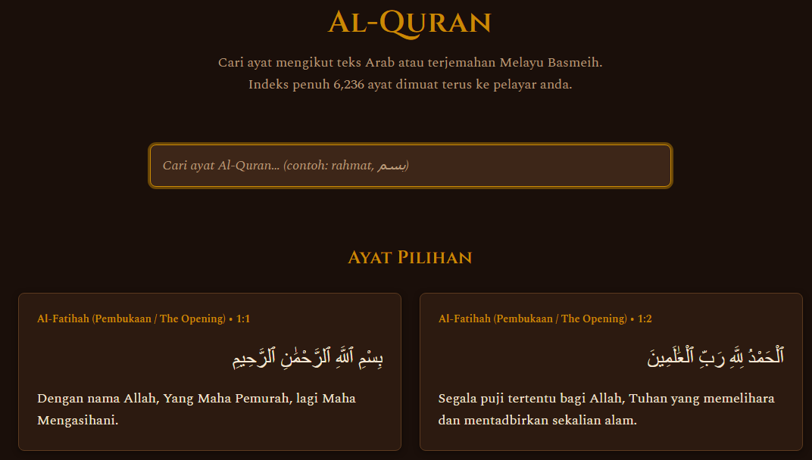
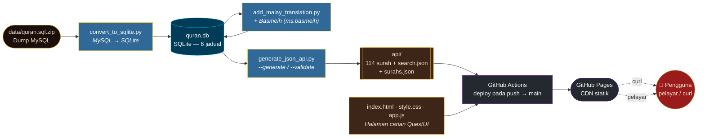
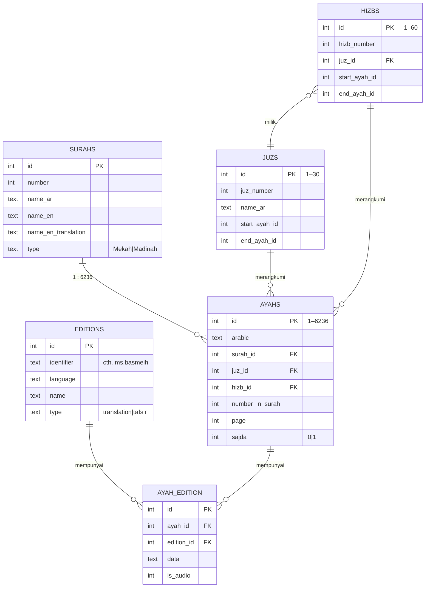
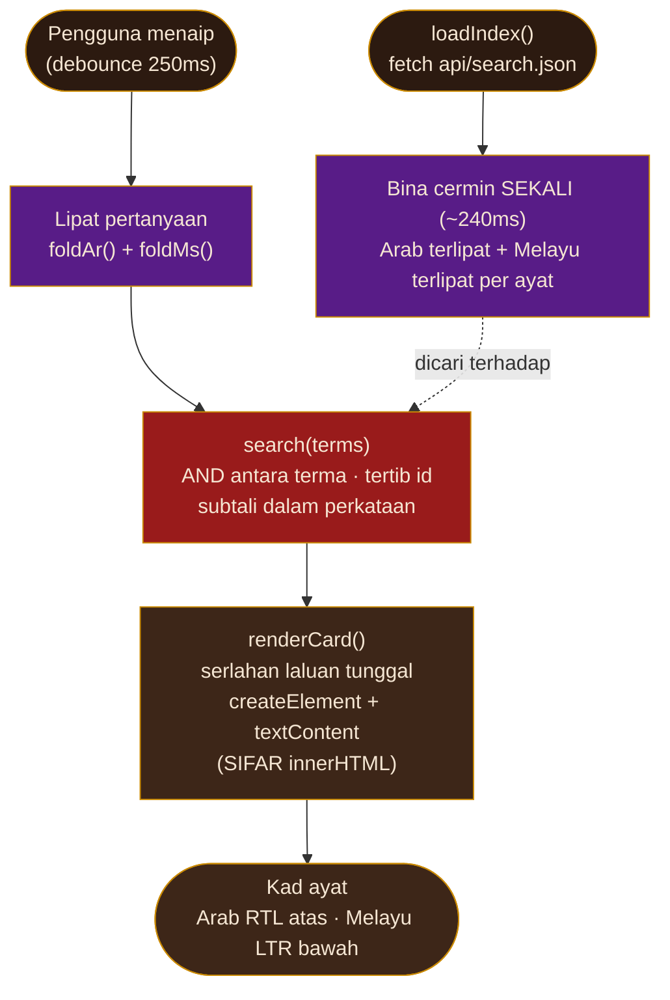

# Al-Quran — Pangkalan Data Quran Melayu

> Cari ayat Al-Quran mengikut teks Arab dan **terjemahan Melayu Basmeih** — terus dalam pelayar, atau melalui `curl`. Indeks penuh 6,236 ayat dimuat terus ke pelayar anda.

> 🇬🇧 **Versi Inggeris:** lihat [README.md](README.md).

> 🍴 **Fork** daripada [`AbdullahGhanem/quran-database`](https://github.com/AbdullahGhanem/quran-database) — ditumpukan semula kepada terjemahan Melayu Basmeih (`ms.basmeih`), dengan API JSON statik di GitHub Pages dan halaman carian pelayar bergaya QuestUI.

---


---

## Panduan Mula Cepat

### Dalam pelayar anda
Buka **<https://C-Fu.github.io/quran-database-malay/>** dan taip satu perkataan — hasil muncul semasa anda menaip (Melayu *dan* Arab, digabungkan).

<p align="center">
  
</p>

> Halaman carian QuestUI langsung — latar belakang gelap hangat, tajuk emas Cinzel, carian sambil-taip dengan padanan diserlahkan. Setiap kad memaparkan **Arab (kanan-ke-kiri)** di atas dan terjemahan **Melayu Basmeih** di bawah.

### Dari baris arahan

Tanpa pengesahan, tanpa pemasangan — JSON itu awam di GitHub Pages. Pilih platform anda untuk setiap tugas.

> **Nota Windows:** PowerShell mengalias `curl` kepada `Invoke-WebRequest` dan `jq` tidak dipasang secara lalai — jadi gunakan contoh **PowerShell** (`Invoke-RestMethod`) di bawah. Jika anda ada `curl` + `jq` sebenar (cth. via WSL, Git Bash, atau `winget install jqlang.jq`), blok macOS/Linux juga berfungsi.

#### 1. Dapatkan keseluruhan surah (Arab + Melayu Basmeih) — Al-Baqarah, 286 ayat

macOS / Linux:
```bash
curl https://C-Fu.github.io/quran-database-malay/api/surah/2.json
```
Windows (PowerShell):
```powershell
Invoke-RestMethod https://C-Fu.github.io/quran-database-malay/api/surah/2.json
```

#### 2. Cari kata kunci dalam terjemahan Melayu

macOS / Linux (guna [`jq`](https://jqlang.github.io/jq/)):
```bash
curl -s https://C-Fu.github.io/quran-database-malay/api/search.json \
  | jq '.[] | select(.malay | contains("rahmat"))'
```
Windows (PowerShell — tanpa `jq`):
```powershell
(Invoke-RestMethod https://C-Fu.github.io/quran-database-malay/api/search.json) |
  Where-Object malay -match 'rahmat' |
  Select-Object surah, ayah, malay
```

#### 3. Senarai kesemua 114 surah

macOS / Linux:
```bash
curl https://C-Fu.github.io/quran-database-malay/api/surahs.json
```
Windows (PowerShell):
```powershell
Invoke-RestMethod https://C-Fu.github.io/quran-database-malay/api/surahs.json
```

Setiap objek ayat mempunyai tepat **5 medan**:
```json
{"arabic":"بِسْمِ ٱللَّهِ ٱلرَّحْمَٰنِ ٱلرَّحِيمِ","malay":"Dengan nama Allah, Yang Maha Pemurah, lagi Maha Mengasihani.","surah":1,"ayah":1,"id":1}
```

---

## Apakah projek ini

Projek ini mengambil keseluruhan Al-Quran (teks Arab + 134 edisi terjemahan) dan **meletakkan terjemahan Melayu Basmeih di barisan hadapan**, didedahkan tiga cara:

1. **API JSON statik yang boleh dicurl** di GitHub Pages — fail per-surah, indeks carian penuh, dan metadata surah.
2. **Halaman carian pelayar** bergaya sistem reka bentuk [QuestUI](https://designmd.ai/chef/questui) — carian segera sambil-taip untuk Arab + Melayu.
3. **Pangkalan data SQLite sedia untuk dicari** (`quran.db`) dengan kekunci asing, kekangan CHECK, indeks, dan jadual rujukan juz/hizb.

**Nilai teras:** *Sesiapa boleh `curl` titik akhir dan mendapatkan ayat Al-Quran (Arab + Melayu Basmeih) melalui carian — pantas, boleh dipercayai, dan tanpa pengesahan.*

Terjemahan Basmeih (`ms.basmeih`, *Tafsir Pimpinan Ar-Rahman*) meliputi kesemua **6,236 ayat** dan diambil daripada API awam [alquran.cloud](https://alquran.cloud).

---

## Bagaimana semuanya berfungsi

Keseluruhannya adalah kisah **saluran binaan + pengehosan statik**. Tiada pelayan memproses permintaan — GitHub Pages menyajikan JSON yang dibina lebih awal, dan pelayar melakukan semua carian di sisi klien.



### Saluran binaan (dijalankan dalam GitHub Actions pada setiap push ke `main`)

1. **`gunzip quran.db.gz`** — nyahmampatkan pangkalan data SQLite yang dibina lebih awal.
2. **`generate_json_api.py --generate`** — baca `quran.db` (baca sahaja), hasilkan `api/` (114 fail per-surah, `search.json` dengan 6,236 ayat, `surahs.json` dengan 114 entri).
3. **`generate_json_api.py --validate`** — sahkan 114/114 fail surah, 6,236 jumlah ayat, 0 ralat. Keluaran bukan sifar menggagalkan binaan.
4. **Pentas `_site/`** — salin `api/` + 3 fail UI (`index.html`, `style.css`, `app.js`) ke direktori pementasan.
5. **`upload-pages-artifact` → `deploy-pages`** — terbitkan ke GitHub Pages.

Hanya `api/` dan 3 fail UI sahaja sampai ke CDN. Fail `quran.db.gz` 60 MB, fail ujian, dan semua skrip kekal di luar tapak awam.

---

## Tiga skrip Python

Semua skrip menggunakan **stdlib Python 3 sahaja** — sifar kebergantungan.

| Skrip | Apa yang dilakukannya |
| --- | --- |
| [`convert_to_sqlite.py`](convert_to_sqlite.py) | Mentakrif dump MySQL (`quran.sql`) menjadi skema SQLite yang ditambah baik: menambah kekangan FK/CHECK, 9 indeks, jadual rujukan `juzs`/`hizbs` yang telah diisi, dan 2 paparan. Pengurai berasaskan-baris yang terhad memori. |
| [`add_malay_translation.py`](add_malay_translation.py) | Mengambil terjemahan Basmeih (`ms.basmeih`) daripada alquran.cloud dan memasukkan baris `editions` + 6,236 baris `ayah_edition` ke dalam `quran.db`. |
| [`generate_json_api.py`](generate_json_api.py) | Membaca `quran.db` (baca sahaja) dan menulis API JSON statik. Mod: `--generate` (tulis `api/`) dan `--validate` (sahkan struktur & bilangan; kod keluar digunakan oleh CI). |

### Jana semula semua secara tempatan

```bash
# 1. Bina semula pangkalan data SQLite daripada dump MySQL
unzip data/quran.sql.zip
python3 convert_to_sqlite.py

# 2. Tambah terjemahan Melayu Basmeih
python3 add_malay_translation.py

# 3. Jana API JSON dan sahkan
python3 generate_json_api.py --generate
python3 generate_json_api.py --validate   # → 114/114 fail, 6236 ayat, 0 ralat

# 4. (pilihan) Jalankan suit ujian UI
node --test app.test.mjs
```

---

## Skema pangkalan data

Enam jadual, 114 surah, 6,236 ayat, 134 edisi (termasuk `ms.basmeih`), 835,624 baris terjemahan (6,236 × 134), 30 juz, 60 hizb.



<details>
<summary><b>Ciri tambahan SQLite</b> (klik untuk kembangkan)</summary>

- **Kekangan kekunci asing + CHECK** (dump MySQL tiada)
- **Indeks** pada `surah_id`, `juz_id`, `hizb_id`, `page`, `number_in_surah`, `sajda`
- **Jadual rujukan `juzs` (30) dan `hizbs` (60) yang telah diisi** dengan julat ayat
- **Paparan:** `surah_stats` (bilangan ayat per surah), `ayah_with_translation` (ayat tercantum + terjemahan)
- PRAGMA: `journal_mode=WAL`, `foreign_keys=ON`, `encoding='UTF-8'`

```python
import sqlite3
db = sqlite3.connect("quran.db")
# Arab + Melayu Basmeih untuk Al-Fatihah
rows = db.execute("""
  SELECT a.text, ae.data
  FROM ayahs a
  JOIN ayah_edition ae ON ae.ayah_id = a.id
  JOIN editions e ON e.id = ae.edition_id
  WHERE a.surah_id = 1 AND e.identifier = 'ms.basmeih'
""").fetchall()
```
</details>

---

## Algoritma carian

Bahagian menarik. Halaman pelayar (`app.js`, **JS vanilla, tiada rangka kerja, tiada langkah binaan**) menjadikan carian segera dengan melipat keseluruhan indeks 6,236 ayat **sekali semasa muat** dan kemudian memadanankan cermin yang dilipat.



### 1. Pelipatan Arab — `foldAr()` (app.js)
Pemadanan mengabaikan diakritik Quran dan varian huruf, jadi menaip **الله** menemui بِسْمِ ٱللَّهِ.

- Tanggalkan **tatweel + tashkeel + tanda Quran**: `[\u0640\u064B-\u0654\u0670\u06D6-\u06ED]` (kashida, harakat, hamzah, wasla, dll.)
- Normalisasi **varian alef** → ا: `آ أ إ ٱ → ا`
- Normalisasi **taa marbutah** → ه: `ة → ه`
- Normalisasi **alef maksura** → ي: `ى → ي`

Berasaskan pendekatan kanonik `ArabicNormalizer` Lucene.

### 2. Pelipatan Melayu/Latin — `foldMs()` (app.js)
Pemadanan mengabaikan tanda aksen dan huruf besar/kecil, jadi menaip **BERIMAN** menemui "beriman".

```js
s.normalize('NFD').replace(/[\u0300-\u036F]/g, '').toLowerCase()
```
Penguraian Unicode **NFD** → tanggalkan tanda diakritik bergabung (`U+0300–036F`) → huruf kecil.

### 3. Cermin lipat-sekali — `search(terms)`
Daripada melipat setiap ayat pada setiap ketukan kekunci, keseluruhan indeks dilipat **sekali semasa muat halaman** menjadi tatasusunan cermin rentetan terlipat `{ar, ms}`. Setiap carian kemudian mengimbas cermin — sebab itulah carian adalah segera (~2.6 ms/ketukan pada keseluruhan 6,236 ayat).

- **AND antara terma**: pertanyaan pelbagai perkataan memerlukan *setiap* terma dipadan (`pemurah langit` → 3 ayat).
- **Melayu + Arab bergabung**: satu kotak carian mencari kedua-dua medan bersama — tiada togol.
- **Tertib id**: hasil kembali dalam tertib id-ayah global (1–6236), tertib Quran semula jadi.

### 4. Serlahan regex sedar-lipat — `arRegex()` + `appendHighlighted()`
Teks ayat **asal** (penuh diakritik) dipaparkan, dengan padanan dibungkus dalam `<mark>`. Regex serlahan dibina dengan melipat *pertanyaan*, kemudian mengembangkan setiap aksara asas menjadi kelas aksara (varian alef, ة/ه, ى/ي) yang disambung dengan kelas elaan diakritik — jadi serlahan mendarat pada glif yang betul walaupun teks yang dipaparkan masih membawa tashkeel.

### 5. "Mungkin maksud anda?" kabur — `levAtMost()` (Levenshtein berjalur)
Apabila carian tidak memulangkan apa-apa, jarak **Levenshtein berjalur** (keluar-awal, ambang ≤1 untuk perkataan pendek / ≤2 untuk panjang) dijalankan ke atas indeks perkataan yang dibina secara malas, dibahagikan mengikut aksara pertama + panjang. Ia mencadangkan sehingga 5 alternatif "Mungkin maksud anda:" — cth. taipan menemui perkataan sebenar.

### 6. Pemaparan selamat XSS — sifar `innerHTML`
**Setiap** nod DOM dibina dengan `createElement` + `textContent` + `setAttribute` — `grep -c innerHTML app.js` memulangkan **0**. Pertanyaan yang direka seperti `` tidak boleh dilaksanakan, kerana ia tidak pernah dihuraikan sebagai HTML. Ini dikuatkuasakan oleh suit ujian (`app.test.mjs`, `node --test`).

---

## Antara Muka Carian (QuestUI)

Halaman bergaya fantasi/RPG yang ditala untuk membaca Al-Quran — latar belakang gelap hangat, tajuk emas Cinzel, badan Spectral, Arab disusun kanan-ke-kiri di atas Melayu.

| | |
|---|---|
| **Palet** | latar `#1A0F0A` · emas `#CA8A04` · merah gelap `#991B1B` (sempadan) · ungu diraja `#581C87` (dekoratif) · perkamen `#F5E6D3` (teks) |
| **Jenis** | Cinzel 600 (tajuk) · Spectral (badan & Arab) — dari Google Fonts |
| **Tataletak** | mobile-first; satu-lajur < 768 px, grid hasil dua-lajur ≥ 768 px |
| **Kelakuan** | debounce 250 ms · had 100 hasil + tunjuk-lagi "Tunjukkan lagi" · keadaan memuat/ralat/cuba-semula · ayat pilihan (Al-Fatihah, Ayatul Kursi, Al-Ikhlas) |

> `<html lang="ms">` — keseluruhan teks UI adalah Bahasa Melayu. Setiap kad hasil: **Arab di atas (RTL, `lang=ar`)** dan **Melayu di bawah (LTR, `lang=ms`)**.

---

## Rujukan API

URL asas: `https://C-Fu.github.io/quran-database-malay` — awam, tanpa pengesahan, tanpa had kadar (CDN statik). Setiap respons ialah `Content-Type: application/json`, UTF-8.

| Titik akhir | Memulangkan |
| --- | --- |
| `GET /api/surah/{n}.json` | Tatasusunan semua ayat dalam surah `n` (1–114) |
| `GET /api/search.json` | Tatasusunan rata semua 6,236 ayat, dalam tertib id-global |
| `GET /api/surahs.json` | Tatasusunan metadata semua 114 surah |

### `GET /api/surah/{n}.json`
Semua ayat dalam sesebuah surah — setiap ayat membawa Arab + Melayu Basmeih.

```bash
curl https://C-Fu.github.io/quran-database-malay/api/surah/2.json   # Al-Baqarah
```

Respons — tatasusunan dengan satu objek per ayat (panjang = bilangan ayat, cth. **286** untuk Al-Baqarah). `id` ialah id ayat global (1–6236):
```json
[
  {"arabic":"بِسْمِ ٱللَّهِ ٱلرَّحْمَٰنِ ٱلرَّحِيمِ الٓمٓ","malay":"Alif, Laam, Miim.","surah":2,"ayah":1,"id":8}
  // …285 ayat lagi (ayah 2..286)
]
```

### `GET /api/search.json`
Indeks carian penuh — tatasusunan rata **3.2 MB** semua 6,236 ayat dalam tertib id-global. Muat turun sekali, kemudian tapis secara tempatan dengan `jq` / PowerShell / Python.

```bash
# Berapa banyak ayat menyebut "rahmat" dalam terjemahan Melayu? (peka huruf besar)
curl -s https://C-Fu.github.io/quran-database-malay/api/search.json \
  | jq '[.[] | select(.malay | contains("rahmat"))] | length'   # → 174
```

Objek ayat tunggal (id 1 = Al-Fatihah 1:1):
```json
{"arabic":"بِسْمِ ٱللَّهِ ٱلرَّحْمَٰنِ ٱلرَّحِيمِ","malay":"Dengan nama Allah, Yang Maha Pemurah, lagi Maha Mengasihani.","surah":1,"ayah":1,"id":1}
```

> Versi peka-huruf-besar&kecil: `select((.malay | ascii_downcase) | contains("rahmat"))`. Setara Windows PowerShell (`Where-Object malay -match`) ada di [Panduan Mula Cepat](#dari-baris-arahan) di atas.

### `GET /api/surahs.json`
Metadata untuk kesemua 114 surah.

```bash
curl https://C-Fu.github.io/quran-database-malay/api/surahs.json
```

Respons (2 daripada 114 yang pertama):
```json
[
  {"number":1,"name_ar":"سورة الفاتحة","name_en":"Al-Faatiha","name_en_translation":"The Opening","type":"Meccan","ayah_count":7},
  {"number":2,"name_ar":"سورة البقرة","name_en":"Al-Baqara","name_en_translation":"The Cow","type":"Medinan","ayah_count":286}
]
```

Direktori `api/` **diabaikan-git** dan dibina oleh GitHub Actions pada setiap push ke `main`, kemudian digerakkan ke GitHub Pages — jadi JSON sentiasa mencerminkan data terkini yang dilakukan.

---

## Struktur projek

```
quran-database-malay/
├─ convert_to_sqlite.py        # Dump MySQL → skema SQLite ditambah baik
├─ add_malay_translation.py    # + Basmeih (ms.basmeih) daripada alquran.cloud
├─ generate_json_api.py        # quran.db → API JSON statik (--generate/--validate)
├─ index.html  style.css  app.js   # Halaman carian pelayar QuestUI (JS vanilla)
├─ app.test.mjs                # suit node:test (membaca api/search.json sebenar)
├─ data/quran.sql.zip          # dump MySQL sumber (~187 MB nyahmampat)
├─ quran.db.gz                 # DB SQLite boleh dihantar (~208 MB nyahmampat)
├─ .github/workflows/deploy-pages.yml   # saluran bina + gerak
└─ api/                        # JSON dijana (diabaikan-git, dibina oleh CI)
```

---

## Menyumbang

Sumbangan dialu-alukan! Terutamanya: lebih banyak semakan silang terjemahan Melayu, penambahbaikan kebolehcapaian, dan penalaan prestasi gelung lipat/carian.

1. **Fork** → cabang ciri (`git checkout -b feature/your-feature`)
2. **Jana semula** secara tempatan dengan skrip di atas untuk membuktikan perubahan anda
3. **Jalankan** `node --test app.test.mjs` dan `python3 generate_json_api.py --validate`
4. **Buka** Pull Request

Sila pastikan terjemahan tepat (rujuk sumber ilmiah yang terkemuka) dan ikuti konvensyen skema sedia ada.

---

## Penghargaan & lesen

- **Sumber hulu:** [`AbdullahGhanem/quran-database`](https://github.com/AbdullahGhanem/quran-database) — pangkalan data Quran MySQL/SQLite asal yang difork oleh projek ini.
- **Terjemahan:** *Tafsir Pimpinan Ar-Rahman* (Basmeih), diperoleh melalui API awam [alquran.cloud](https://alquran.cloud) sebagai edisi `ms.basmeih`.
- **Reka bentuk:** sistem reka bentuk [QuestUI](https://designmd.ai/chef/questui).

Projek ini adalah sumber terbuka. Teks Al-Quran adalah domain awam.
